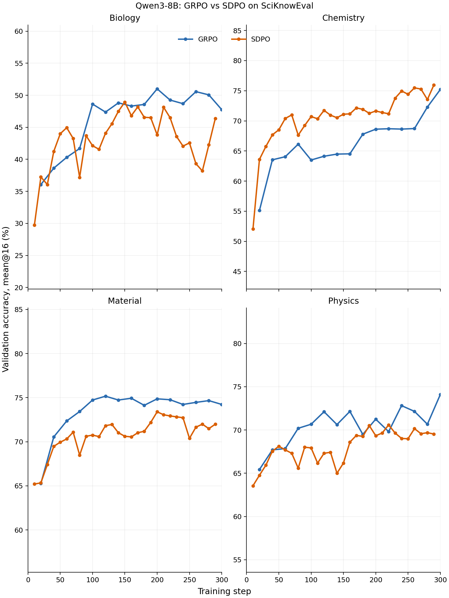

# Qwen3-8B GRPO vs SDPO: mean@16



The plot shows the W&B `val-core/sciknoweval_{domain}/acc/mean@16` metric for biology, chemistry, material, and physics against `training/global_step`. Values are shown as percentages. The underlying W&B values are preserved in [grpo_sdpo_mean16.csv](grpo_sdpo_mean16.csv).

Each panel's y-axis spans its observed minimum minus 0.1 to its observed maximum plus 0.1 in accuracy units (10 percentage points of padding at each end). The figure's height-to-width ratio is 4:3.

| Method | W&B run | Available validation steps |
| --- | --- | --- |
| GRPO | [FINAL-GRPO-mbs-16-train32-rollout8-lr3e-6-modelQwen/Qwen3-8B](https://wandb.ai/harshg5799/SDPO2-hrxu/runs/kwe6y1fy) | 20–300, every 20 steps; run continues to step 660 |
| SDPO | [FINAL-SDPO-noicl-isclip2.0-mbs-32-train32-rollout8-lr1e-5-alpha0.5-modelQwen/Qwen3-8B](https://wandb.ai/harshg5799/SDPO2-hrxu/runs/mq08zmcp) | 10–290, every 10 steps; no step 300 point logged |

Both runs use Qwen3-8B and training batch size 32. GRPO uses actor mini batch size 16 and learning rate 3e-6; SDPO uses mini batch size 32, learning rate 1e-5, distillation top-k 100, and alpha 0.5. The plot stops at step 300 and does not extrapolate the SDPO curve beyond its last recorded validation point at step 290.

Regenerate the CSV and PNG with a W&B login and an environment containing `wandb` and `matplotlib`:

```bash
python docs/plots/plot_grpo_sdpo_mean16.py
```
